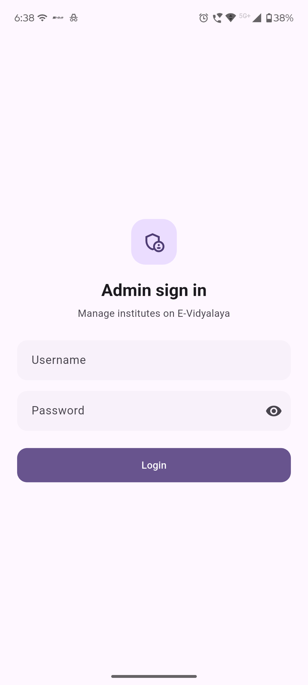
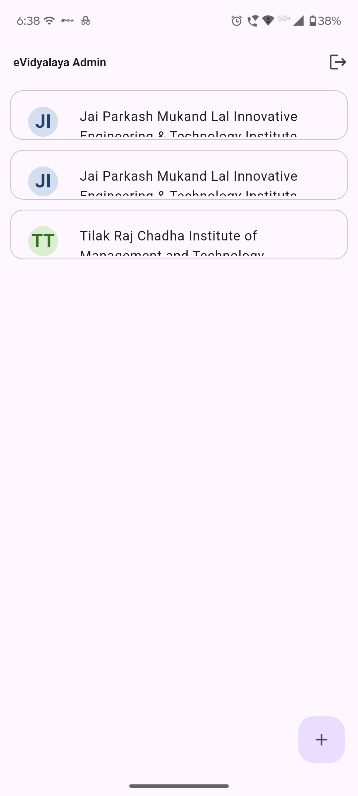
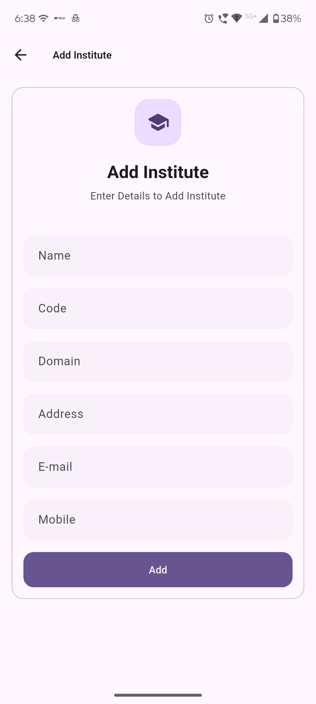
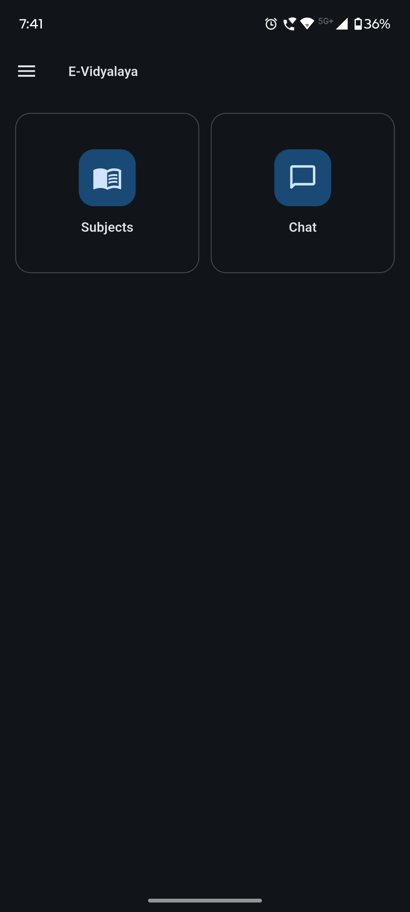
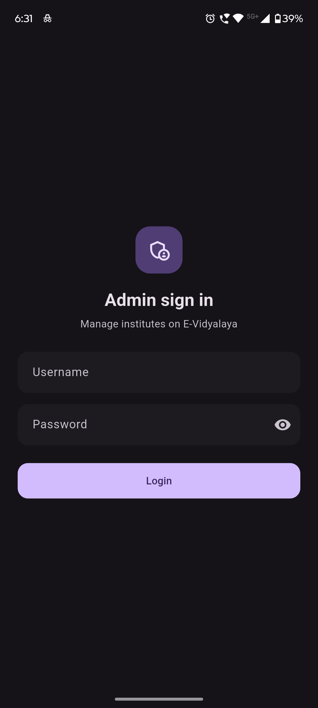
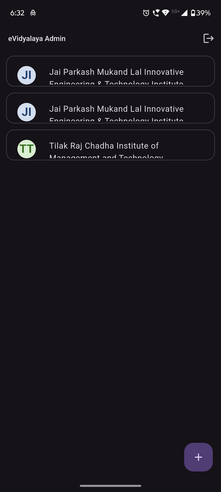
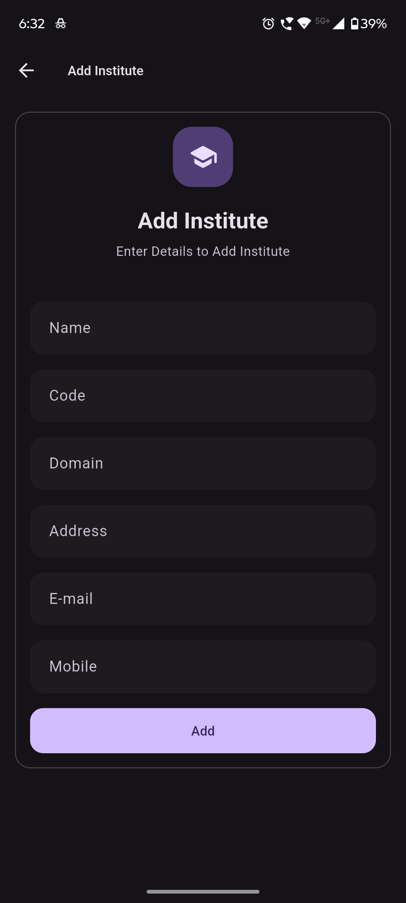
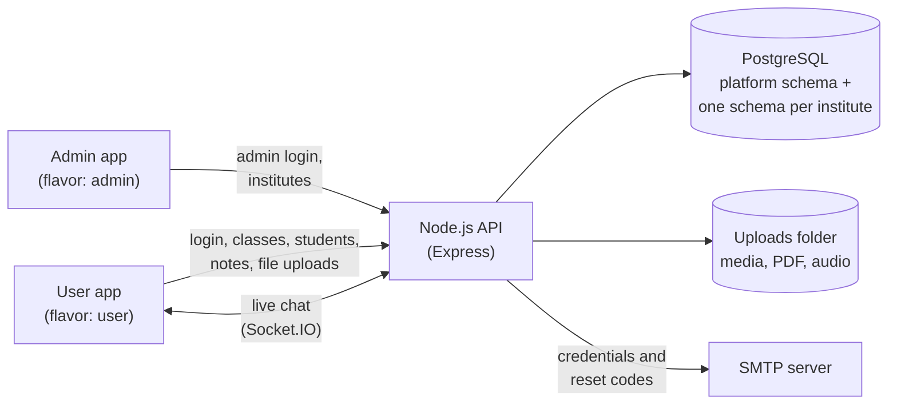

# E-Vidyalaya

**A campus management platform for schools and colleges: one Flutter codebase, two apps.**

<p>
  <a href="https://e-vidyalaya.onrender.com/"></a>
  <a href="https://github.com/rks369/e-vidyalaya/releases/latest"></a>
  
  
  
  
  
  <a href="LICENSE"></a>
</p>

<p align="center">
  <picture>
    <source media="(prefers-color-scheme: dark)" srcset="docs/screenshots/hero-dark.png">
    
  </picture>
</p>

> **How it started.** A B.Tech project (2022–23): two Flutter apps that talked straight to a MySQL database. Rebuilt in 2026 as one Flutter app with two flavors on a Node.js API, with role-based access and every secret moved out of the code.

## Try it

| What | Link |
| --- | --- |
| User app (web) | https://e-vidyalaya.onrender.com/ |
| Admin app (web) | https://e-vidyalaya-admin.onrender.com |
| API health | https://e-vidyalaya-api.onrender.com/health |
| Android APKs (user and admin) | [Latest release](https://github.com/rks369/e-vidyalaya/releases/latest) |

The apps run on Render's free tier, so the first request after a quiet period can take up to a minute while the API wakes up.

## Overview

| App | Flavor | For | What it does |
| --- | --- | --- | --- |
| **eVidyalaya Admin** | `admin` | Platform operator | Creates institutes and their director accounts |
| **eVidyalaya** | `user` | Director, Teacher, Student | Role-based institute experience: classes, notes, chat |

The two Android apps have different application IDs (`com.asyncit.evidyalaya` and `com.asyncit.evidyalaya.admin`), so they install side by side. On the web they are two separate sites.

**Roles:** Admin → Director → Teacher → Student. Each role creates the next one down.

1. An **admin** (created once from the command line) adds an **institute**, which creates its **director**.
2. The **director** adds teachers, students, classes and subjects. A **teacher** can add students to their own class.
3. Directors and teachers upload **notes** (images, video, audio, PDF, Office files) to subjects; students open them.
4. Everyone in an institute can **chat**.

Passwords are generated by the server and e-mailed. User IDs look like `name@domain`, and the part after the `@` picks the institute, so two institutes never see each other's data.

## Features

**Admin**
- Sign in with an admin account (created from the command line, never through the app)
- List all institutes
- Add an institute: creates it and its director account, and shows the director's User ID

**Director**
- Create classes with a class teacher; create subjects with a subject teacher
- Add teachers and students; see the students and subjects of each class
- Upload notes to a subject: camera (mobile), image, video, audio or document
- Chat

**Teacher**
- See own classes, subjects and students
- Add students to own class
- Upload notes to own subjects
- Chat

**Student**
- Browse the subjects of the class and open notes (image previews, file-type icons)
- Chat

**Everyone**
- Sign in per institute; the session is kept on the device
- Forgot password: an e-mailed one-time code (works once, expires in 15 minutes, 5 tries)
- Change password and view profile
- Real-time chat over Socket.IO: class group chat, subject group chat and one-to-one, with message history
- Offline and error screens
- Light and dark theme that follows the device
- Adaptive layouts for phone, tablet and desktop browser

## Screenshots

### Highlights

<table>
  <tr>
    <td align="center"><br><sub>Director dashboard</sub></td>
    <td align="center"><br><sub>Classes</sub></td>
    <td align="center"><br><sub>Class group chat</sub></td>
  </tr>
</table>

<table>
  <tr>
    <td align="center"><br><sub>Director dashboard on desktop web</sub></td>
  </tr>
</table>

### Light and dark

The theme follows the device setting.

<table>
  <tr>
    <th align="center">Light</th>
    <th align="center">Dark</th>
  </tr>
  <tr>
    <td align="center"></td>
    <td align="center"></td>
  </tr>
  <tr>
    <td align="center"></td>
    <td align="center"></td>
  </tr>
  <tr>
    <td align="center"></td>
    <td align="center"></td>
  </tr>
</table>

### Responsive

The same screen at three widths. The side menu becomes a permanent panel from 840 px.

<table>
  <tr>
    <td align="center" width="20%"><br><sub>Mobile, 390 px</sub></td>
    <td align="center" width="30%"><br><sub>Tablet, 834 px</sub></td>
    <td align="center" width="50%"><br><sub>Desktop, 1440 px</sub></td>
  </tr>
</table>

### Full gallery

<details>
<summary><b>🛠️ Admin app</b></summary>
<br>

<table>
  <tr>
    <td align="center"><br><sub>Admin sign in</sub></td>
    <td align="center"><br><sub>Institutes</sub></td>
    <td align="center"><br><sub>Add an institute</sub></td>
  </tr>
  <tr>
    <td align="center"><br><sub>Director credentials dialog</sub></td>
    <td></td>
    <td></td>
  </tr>
</table>

</details>

<details>
<summary><b>🏫 Director</b></summary>
<br>

<table>
  <tr>
    <td align="center"><br><sub>Login</sub></td>
    <td align="center"><br><sub>Forgot password</sub></td>
    <td align="center"><br><sub>Director dashboard</sub></td>
  </tr>
  <tr>
    <td align="center"><br><sub>Classes</sub></td>
    <td align="center"><br><sub>Subjects of a class</sub></td>
    <td align="center"><br><sub>Students of a class</sub></td>
  </tr>
  <tr>
    <td align="center"><br><sub>Create a class</sub></td>
    <td align="center"><br><sub>Teachers</sub></td>
    <td align="center"><br><sub>Add a teacher</sub></td>
  </tr>
  <tr>
    <td align="center"><br><sub>Add a student</sub></td>
    <td align="center"><br><sub>Notes of a subject</sub></td>
    <td align="center"><br><sub>Attach a note</sub></td>
  </tr>
  <tr>
    <td align="center"><br><sub>Side menu</sub></td>
    <td align="center"><br><sub>Profile</sub></td>
    <td align="center"><br><sub>Change password</sub></td>
  </tr>
</table>

</details>

<details>
<summary><b>👩‍🏫 Teacher</b></summary>
<br>

<table>
  <tr>
    <td align="center"><br><sub>Teacher dashboard</sub></td>
    <td align="center"><br><sub>Own classes</sub></td>
    <td align="center"><br><sub>Own subjects</sub></td>
  </tr>
  <tr>
    <td align="center"><br><sub>Own students</sub></td>
    <td align="center"><br><sub>Add a student to own class</sub></td>
    <td></td>
  </tr>
</table>

</details>

<details>
<summary><b>🎓 Student</b></summary>
<br>

<table>
  <tr>
    <td align="center"><br><sub>Student dashboard</sub></td>
    <td align="center"><br><sub>Subjects of the class</sub></td>
    <td align="center"><br><sub>Notes of a subject</sub></td>
  </tr>
</table>

</details>

<details>
<summary><b>💬 Chat</b></summary>
<br>

<table>
  <tr>
    <td align="center"><br><sub>Chat: classes</sub></td>
    <td align="center"><br><sub>Chat: subjects</sub></td>
    <td align="center"><br><sub>Chat: teachers</sub></td>
  </tr>
  <tr>
    <td align="center"><br><sub>Chat: students</sub></td>
    <td align="center"><br><sub>Class group chat</sub></td>
    <td align="center"><br><sub>One-to-one chat</sub></td>
  </tr>
</table>

</details>

<details>
<summary><b>🌙 Dark theme</b></summary>
<br>

<table>
  <tr>
    <td align="center"><br><sub>Login (dark)</sub></td>
    <td align="center"><br><sub>Director dashboard (dark)</sub></td>
    <td align="center"><br><sub>Classes (dark)</sub></td>
  </tr>
  <tr>
    <td align="center"><br><sub>Create a class (dark)</sub></td>
    <td align="center"><br><sub>Notes of a subject (dark)</sub></td>
    <td align="center"><br><sub>Student dashboard (dark)</sub></td>
  </tr>
  <tr>
    <td align="center"><br><sub>Chat: classes (dark)</sub></td>
    <td align="center"><br><sub>Class group chat (dark)</sub></td>
    <td align="center"><br><sub>Side menu (dark)</sub></td>
  </tr>
</table>

<table>
  <tr>
    <td align="center"><br><sub>Admin sign in (dark)</sub></td>
    <td align="center"><br><sub>Institutes (dark)</sub></td>
    <td align="center"><br><sub>Add an institute (dark)</sub></td>
  </tr>
</table>

</details>

<details>
<summary><b>🖥️ Web & desktop</b></summary>
<br>

**User app, light**

<table>
  <tr>
    <td align="center"><br><sub>Login (light)</sub></td>
  </tr>
  <tr>
    <td align="center"><br><sub>Director dashboard (light)</sub></td>
  </tr>
  <tr>
    <td align="center"><br><sub>Classes (light)</sub></td>
  </tr>
  <tr>
    <td align="center"><br><sub>Notes of a subject (light)</sub></td>
  </tr>
  <tr>
    <td align="center"><br><sub>Class group chat (light)</sub></td>
  </tr>
</table>

**User app, dark**

<table>
  <tr>
    <td align="center"><br><sub>Login (dark)</sub></td>
  </tr>
  <tr>
    <td align="center"><br><sub>Director dashboard (dark)</sub></td>
  </tr>
  <tr>
    <td align="center"><br><sub>Classes (dark)</sub></td>
  </tr>
  <tr>
    <td align="center"><br><sub>Notes of a subject (dark)</sub></td>
  </tr>
  <tr>
    <td align="center"><br><sub>Class group chat (dark)</sub></td>
  </tr>
</table>

**Admin app, light**

<table>
  <tr>
    <td align="center"><br><sub>Admin sign in (light)</sub></td>
  </tr>
  <tr>
    <td align="center"><br><sub>Institutes (light)</sub></td>
  </tr>
  <tr>
    <td align="center"><br><sub>Add an institute (light)</sub></td>
  </tr>
</table>

**Admin app, dark**

<table>
  <tr>
    <td align="center"><br><sub>Admin sign in (dark)</sub></td>
  </tr>
  <tr>
    <td align="center"><br><sub>Institutes (dark)</sub></td>
  </tr>
  <tr>
    <td align="center"><br><sub>Add an institute (dark)</sub></td>
  </tr>
</table>

</details>

## Architecture



- **Flavors, not forks.** One codebase builds two apps. Each entry point (`main_admin.dart`, `main_user.dart`) hands the shared app shell its own route table and Bloc providers, so the other flavor's screens are never registered and are tree-shaken out of the build. Separate application IDs let both install on one phone.
- **An API instead of direct database access.** The original apps held database credentials on the client. Now only the API talks to PostgreSQL: it keeps the secrets, validates input, rate-limits sign-in and password routes, and enforces roles on every request.
- **Access control at two levels.** In the app, the admin flavor registers only its own routes and the user flavor registers one route that opens the dashboard for the signed-in role; anything else shows "Not found". On the server, JWTs carry the role, `requireRole` guards each route, and admin and institute tokens are rejected by each other's routes and by the chat socket.
- **One schema per institute.** Each institute lives in its own PostgreSQL schema, so no query filters by institute. A shared `platform` schema holds the institute list and admin accounts.

## Tech stack

| Layer | Technology |
| --- | --- |
| Frontend | Flutter (stable), Dart 3, Material 3, `http`, `socket_io_client` |
| State management | `flutter_bloc` (Bloc / Cubit) |
| Backend | Node.js 20+, Express 5, Socket.IO, JWT, `scrypt` password hashing, Multer, Nodemailer, Helmet |
| Database | PostgreSQL through plain `pg` (no ORM), SQL migrations, schema per institute |
| Hosting | Render (API and two static web sites), GitHub Releases (APKs) |
| Tooling | Flutter flavors, `flutter_lints`, `render.yaml` blueprint, VS Code launch configs |

## Project layout

```text
.
├── backend/                  Node.js API
│   ├── migrations/           SQL for the platform schema and the per-institute schema
│   ├── scripts/              migrate, create-admin, clean-temp
│   └── src/                  routes, modules, middleware, sockets, util
├── frontend/                 Flutter app (admin and user flavors)
│   ├── lib/
│   │   ├── core/             API client, theme, flavors, shared widgets
│   │   ├── features/         admin, auth, director, teacher, student, chat
│   │   ├── main_admin.dart   admin entry point
│   │   └── main_user.dart    user entry point
│   └── android/              admin and user product flavors
├── docs/screenshots/         README images and the capture checklist
└── render.yaml               Render blueprint for the API
```

## Getting started

**Prerequisites:** Node.js 20+, a PostgreSQL database, Flutter (stable, Dart `^3.13.7`) with the Android SDK, and an SMTP account (passwords are only delivered by e-mail, so use a mail sandbox such as Mailtrap while testing).

**Backend**

```bash
cd backend
cp .env.example .env    # fill in the database, JWT_SECRET and SMTP settings
npm install
npm run migrate         # creates the platform schema and every institute schema
npm run create-admin    # asks for a username, e-mail and password
npm run dev             # http://localhost:3000
```

**Frontend**

```bash
cd frontend
cp env.example.json env.json   # set API_BASE_URL (http://10.0.2.2:3000 on an Android emulator)
flutter pub get
```

`env.json` is git-ignored and is read at build time through `--dart-define-from-file`. Run everything from `frontend/`:

```bash
flutter run --flavor user  -t lib/main_user.dart  --dart-define-from-file=env.json
flutter run --flavor admin -t lib/main_admin.dart --dart-define-from-file=env.json
flutter run -d chrome -t lib/main_user.dart --dart-define-from-file=env.json
flutter build apk --release --flavor user -t lib/main_user.dart --dart-define-from-file=env.json
```

`--flavor` exists only on Android, iOS and macOS, so the web and desktop targets pick the app by entry point alone (`-t lib/main_admin.dart` for the admin app). Build the admin APK with `--flavor admin -t lib/main_admin.dart`.

**First run:** sign in to the Admin app, add an institute, sign in as its director with the e-mailed password, then add teachers, classes, subjects, students and notes. More in [backend/README.md](backend/README.md) and [frontend/README.md](frontend/README.md).

## Deployment

- **API:** deploy `backend/` to Render using the blueprint in `render.yaml`, set the variables from `backend/.env.example`, then run `npm run migrate` and `npm run create-admin` against the production database (point a local `.env` at it).
- **Web:** build the user and admin apps separately with `flutter build web` and host each as its own static site. Build commands are in the [frontend guide](frontend/README.md#build).
- **Android:** build one APK per flavor (commands above) and attach them to a GitHub release.

## Detailed docs

- [backend/README.md](backend/README.md): configuration, endpoints, chat events, rate limits, uploads
- [frontend/README.md](frontend/README.md): flavors, setup, run and build commands

## License

Released under the [MIT License](LICENSE).

## Author

Ritesh · GitHub [@rks369](https://github.com/rks369) · [LinkedIn](https://www.linkedin.com/in/rks369/)
