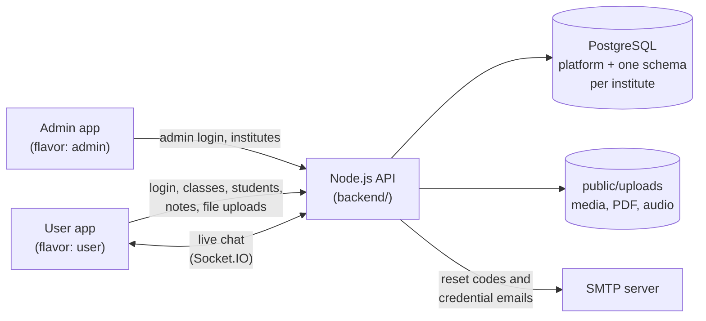

# eVidyalaya

A multi-institute school management app: one Flutter codebase that builds two separate Android apps, **Admin** and **User**, on top of one Node.js API.

> Originally developed Nov 2022 – Feb 2026 as two repos; merged into a single flavored app with secrets removed.

| Part | What it is | Guide |
| --- | --- | --- |
| **Backend** | Node.js + Express API, PostgreSQL (one schema per institute), Socket.IO chat, SMTP email | [backend/README.md](backend/README.md) |
| **Frontend** | Flutter app with two flavors (`admin`, `user`) for Android, iOS, web, macOS, Windows and Linux | [frontend/README.md](frontend/README.md) |

## Overview

| App | Flavor | Who uses it | What it does |
| --- | --- | --- | --- |
| **eVidyalaya Admin** | `admin` | Platform operator | Creates institutes and their director accounts |
| **eVidyalaya** | `user` | Director, Teacher, Student | Login and the role-based school experience |

The two APKs have different application IDs (`…evidyalaya` and `…evidyalaya.admin`), so they install side by side.

## Features

**Admin**
- Sign in with an admin account (created from the command line, never through the app)
- List all institutes
- Add an institute: creates the institute and its director account (credentials are emailed by the backend)
- Forgot and change password

**Director**
- Manage classes and subjects
- Add teachers and students (credentials are emailed), assign students to classes
- Upload study notes per subject (images, video, audio, PDF and documents)
- 1:1 chat and group chat (by class, subject, teachers, students)

**Teacher**
- View assigned classes, subjects and students; add students
- 1:1 chat and group chat

**Student**
- Browse subjects and open notes (images, video, audio, PDF and documents)
- 1:1 chat and group chat

**Everyone (user app)**
- Login per institute, forgot password (emailed one-time code), change password
- Profile, about, contact, privacy policy and terms

## Architecture



- **One database, one schema per institute.** Institute data never mixes: each institute lives in its own `inst_<id>_<code>` schema, and a shared `platform` schema holds the institute list and the admin accounts.
- **Two kinds of sign-in.** Institute users (director, teacher, student) sign in per institute. Administrators have separate accounts, created only by a command-line script.
- **Everything goes through the API.** The apps have no direct database access and no Firebase.

## Project layout

```
backend/          # Node.js API (Express, PostgreSQL, Socket.IO, SMTP)   -> backend/README.md
frontend/         # Flutter app (admin and user flavors)                 -> frontend/README.md
docs/             # demo walkthrough and screenshots
render.yaml       # Render deployment for backend/
```

## Tech stack

Flutter · Dart · Bloc/Cubit · Node.js + Express · PostgreSQL (plain `pg`) · Socket.IO · Nodemailer (SMTP)

## Screenshots

The full list of cases, the data to enter and the file names are in the [demo walkthrough](docs/WALKTHROUGH.md).

**Admin app**

| Sign in | Institutes | Add institute |
| --- | --- | --- |
|  |  |  |

**User app**

| Login | Director dashboard | Classes |
| --- | --- | --- |
|  |  |  |

| Notes | Group chat | Student notes |
| --- | --- | --- |
|  |  |  |

**Dark theme and wide web layout**

| Dashboard, dark | Dashboard, web | Group chat, dark |
| --- | --- | --- |
|  |  |  |

## Getting started

1. **Backend**: set up PostgreSQL, fill in `backend/.env`, then `npm install` and `npm run migrate`. Details in [backend/README.md](backend/README.md).
2. **First admin**: `npm run create-admin` in `backend/` (asks for username, email and password).
3. **Run the API**: `npm run dev` in `backend/`.
4. **Frontend**: `flutter pub get` in `frontend/`, copy `env.example.json` to `env.json`, then run an app. Details in [frontend/README.md](frontend/README.md).

## Known limitations / next steps

- iOS flavors are not configured yet; only Android flavors exist.
- Chat history from the old Firestore chat is not migrated; conversations start empty.
- Uploaded files are public by URL (unguessable names, no login needed to read them).
- The backend has no automated tests at the moment.
- On Render's free tier, uploaded files are lost on redeploy and outgoing email is blocked (see [backend/README.md](backend/README.md#deployment)).
