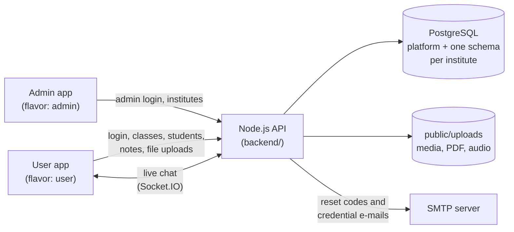

# eVidyalaya

A multi-institute college and school management system. One Flutter codebase builds two apps, **Admin** and **User**, for Android and the web (desktop builds work too), on top of one Node.js API with a PostgreSQL database.

> Originally developed Nov 2022 – Feb 2026 as two repositories; merged into a single flavored app with secrets removed.

| Part | What it is | Guide |
| --- | --- | --- |
| **Backend** | Node.js + Express API, PostgreSQL (one schema per institute), Socket.IO chat, SMTP email | [backend/README.md](backend/README.md) |
| **Frontend** | Flutter app with two flavors (`admin`, `user`) for Android, web, Windows, Linux, iOS and macOS | [frontend/README.md](frontend/README.md) |

## Overview

| App | Flavor | Who uses it | What it does |
| --- | --- | --- | --- |
| **eVidyalaya Admin** | `admin` | Platform operator | Creates institutes and their director accounts |
| **eVidyalaya** | `user` | Director, Teacher, Student | Login and the role-based institute experience |

The two Android apps have different application IDs (`com.asyncit.evidyalaya` and `com.asyncit.evidyalaya.admin`), so they install side by side. On the web they are two separate sites.

## How it works

1. A **platform admin** is created once from the command line. The admin signs in to the Admin app and adds an **institute**.
2. Adding an institute creates its **director** account. The director's User ID and password are generated by the server and sent to the institute's e-mail address.
3. The director adds **teachers**, **students**, **classes** and **subjects**. Their User IDs and passwords are e-mailed too.
4. Teachers and the director upload **notes** (images, video, audio, PDF, Office files) to subjects. Students open them.
5. Everyone in an institute can use **chat**.

User IDs look like `name@domain`. The part after the `@` picks the institute, so two institutes never see each other's data.

## Features

**Admin app**
- Sign in with an admin account (created from the command line, never through the app)
- List all institutes
- Add an institute: creates the institute and its director account (credentials are e-mailed by the backend)

**Director**
- Manage classes and subjects
- Add teachers and students, and assign students to classes
- Upload study notes per subject
- 1:1 and group chat (by class, subject, teachers, students)

**Teacher**
- View own classes, subjects and students; add students to own class
- Upload notes to own subjects

**Student**
- Browse subjects of the class and open notes

**Everyone (user app)**
- Login per institute, forgot password (e-mailed one-time code), change password
- Profile, about, contact, privacy policy and terms
- Light and dark theme that follows the device, and layouts that fill phones, tablets and desktop browsers

## Architecture



- **One database, one schema per institute.** Each institute lives in its own `inst_<id>_<code>` schema, and a shared `platform` schema holds the institute list and the admin accounts.
- **Two kinds of sign-in.** Institute users (director, teacher, student) sign in per institute. Administrators have separate accounts, created only by a command-line script.
- **Everything goes through the API.** The apps have no direct database access and no Firebase.

## Project layout

```
backend/          # Node.js API (Express, PostgreSQL, Socket.IO, SMTP)   -> backend/README.md
frontend/         # Flutter app (admin and user flavors)                 -> frontend/README.md
docs/             # screenshots
render.yaml       # Render blueprint for the backend API
```

## Tech stack

| Layer | Technology |
| --- | --- |
| App | Flutter, Dart, Bloc/Cubit, Material 3 |
| API | Node.js 20+, Express 5, Socket.IO |
| Database | PostgreSQL through plain `pg` (no ORM) |
| E-mail | Nodemailer over SMTP |
| Hosting | Render (API), any static host (web apps) |

## Screenshots

**Admin app**

| Sign in | Institutes | Add institute |
| --- | --- | --- |
|  |  |  |

**User app**

| Login | Director dashboard | Classes |
| --- | --- | --- |
|  |  |  |

| Notes | Group chat | Student notes |
| --- | --- | --- |
|  |  |  |

**Dark theme and wide web layout**

| Dashboard, dark | Dashboard, web | Group chat, dark |
| --- | --- | --- |
|  |  |  |

## Getting started

You need Node.js 20 or newer, a PostgreSQL database, Flutter (stable) and an SMTP account for e-mail.

1. **Backend**: `cp backend/.env.example backend/.env`, fill in the database, `JWT_SECRET` and SMTP settings, then in `backend/` run `npm install` and `npm run migrate`. Details in [backend/README.md](backend/README.md).
2. **First admin**: `npm run create-admin` in `backend/` (asks for a username, e-mail and password).
3. **Run the API**: `npm run dev` in `backend/` (listens on `http://localhost:3000`).
4. **Frontend**: in `frontend/` run `flutter pub get`, copy `env.example.json` to `env.json`, set `API_BASE_URL`, then run an app. Details in [frontend/README.md](frontend/README.md).
5. **Create the data** in this order: sign in to the Admin app and add an institute, sign in as its director with the e-mailed password, then add teachers, classes, subjects, students and notes.

New passwords reach people only by e-mail, so use addresses you can open while testing.

## Deployment

- **API**: deploy `backend/` on Render (blueprint in `render.yaml`), then run `npm run migrate` and `npm run create-admin` against the production database. See [Deployment in the backend guide](backend/README.md#deployment).
- **Web apps**: build the user and admin apps separately and host them as two static sites. See [Build](frontend/README.md#build) in the frontend guide.
- **Android**: build one APK or app bundle per flavor. Release builds are signed with the debug key until you add your own signing config.

## Known limitations

- Chat only works for the director today. Teachers and students open the same chat screens, which load their lists from director-only API routes, so the tabs are empty for them.
- There is no edit or delete for classes, subjects, people, notes or institutes, and the API has no update or delete routes yet.
- The admin app has sign-in but no forgot-password or change-password screen, although the backend supports both.
- The privacy policy and terms text is placeholder text and must be replaced before the app is published.
- The theme follows the device or browser setting; there is no in-app theme switch.
- iOS flavors are not configured; only the Android flavors exist.
- Chat history from the old Firestore chat is not migrated; conversations start empty.
- Uploaded files are public by URL (random names, no login needed to read them).
- On Render's free tier, uploaded files are lost on redeploy and outgoing SMTP is blocked (see [backend/README.md](backend/README.md#deployment)).
- The backend has no automated tests yet. The frontend has 37 widget and unit tests.
